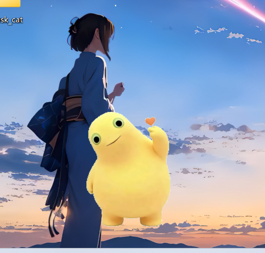
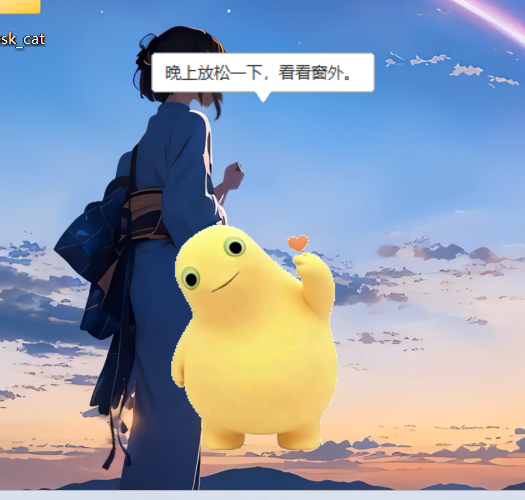
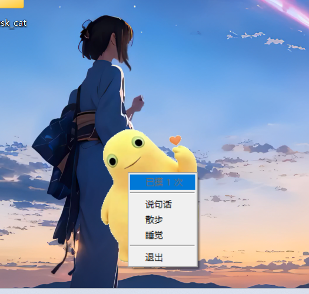

# 桌面宠物「小黄」——透明穿透桌宠

《2026 纳新笔试题》第四题「君子六艺——御」二档作品：一个能常驻桌面的小宠物，
有界面、有交互（点击、拖拽、说话、走动），关掉再打开还记得你。

代码是我在网页版 DeepSeek 的同一个会话里逐轮迭代得出的，仓库里是最终跑通的那一版；
形象用了一张外部卡通素材（`res/pet.png`），程序负责抠白底、缩放与显示。

## 效果

| 待机 | 说话 | 右键菜单 |
| --- | --- | --- |
|  |  |  |

## 目录结构

```
03-desktop-pet/
├── main.py          # 入口：创建 PetApp 并进入主循环
├── pet_app.py       # 窗口、画布、动画循环、气泡、交互、持久化
├── pet_window.py    # 无边框 / 置顶 / 色键透明 / WM_NCHITTEST 点击穿透
├── animation.py     # 状态机：idle / walk / sleep / drag / fall + 呼吸、眨眼、跳跃
├── storage.py       # state.json 读写（位置、摸头次数、时间段）
├── dialogue.py      # 台词加载与按时段抽取
├── cat_draw.py      # 读取 res/pet.png，抠白底、缩放、缓存
├── res/
│   ├── pet.png      # 形象素材
│   └── dialogue.txt # 台词，一行一句，[period] 分段
└── docs/            # 截图
```

## 运行

```bat
pip install pillow
python main.py
```

只依赖 Python 标准库 + Pillow，没有图形框架、没有网络请求。

## 交互

| 操作 | 反应 |
| --- | --- |
| 左键单击 | 头顶冒一句台词（几秒后消失），并跳一下 |
| 左键双击 | 睡觉，再点一下醒来 |
| 按住拖动 | 拎起来，松手掉回屏幕底部 |
| 右键 | 菜单：说句话 / 散步 / 睡觉 / 退出（顶部显示“已摸 N 次”） |
| 闲置一段时间 | 自己沿屏幕底部走动 |

## 三个关键点

1. **透明**：`-transparentcolor` 把指定颜色整片抠成透明，画布铺这个颜色，
   形象图的白底也换成这个颜色，于是只有角色可见。
2. **点击穿透**：给窗口加 `WS_EX_LAYERED | WS_EX_TRANSPARENT`，再子类化窗口过程拦截
   `WM_NCHITTEST`——鼠标落在透明像素返回 `HTTRANSPARENT`（交给桌面），
   落在角色像素交给默认处理（窗口自己收点击）。
3. **记忆**：位置、摸头次数写进 `%APPDATA%\DesktopPet\state.json`，
   退出时和每 30 秒各存一次，读档失败自动退回默认值。

## 已知不足

- 形象是贴图，四种表情目前共用同一张图，眨眼“看不出来”；
- 边缘按二值处理，放大看会有一点硬边；
- 只适配 Windows（依赖 `WM_NCHITTEST` 与色键透明）。

## 素材说明

`res/pet.png` 为网络卡通素材，仅用于个人练习，非本人原创绘制。